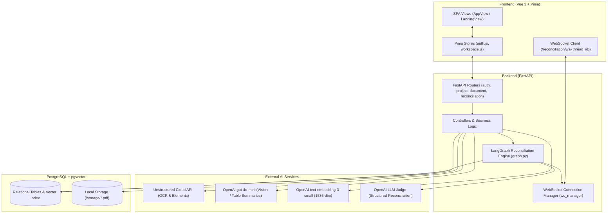
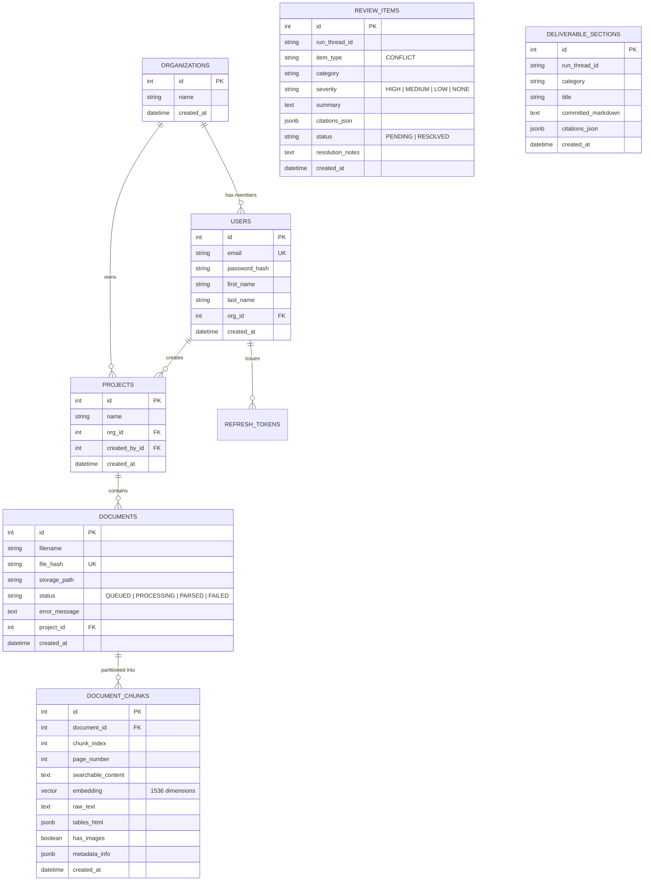
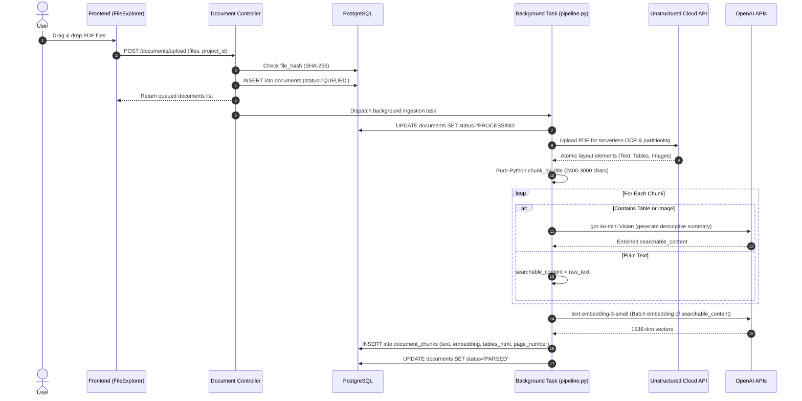
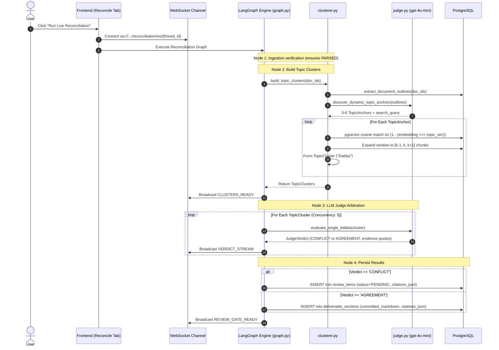
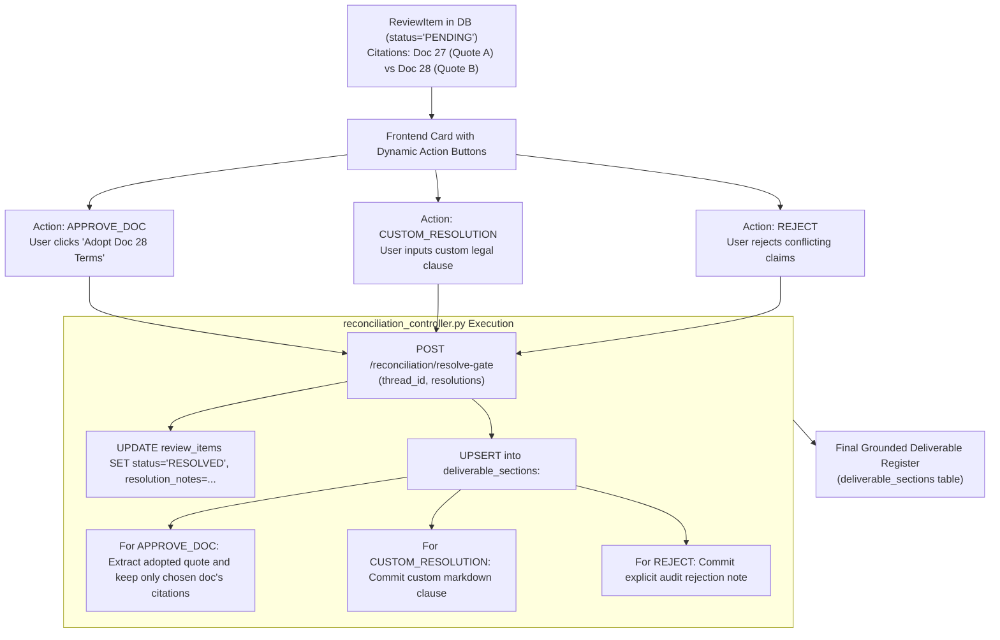
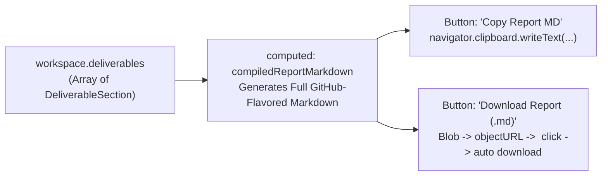

# SuperDocs Developer Guide: Architecture, Workflows & Database

This document explains the end-to-end mechanics of **SuperDocs** for developers. It details how the system runs, how state transitions through PostgreSQL, how database rows mutate at each step, and how the core AI/ML reconciliation pipeline functions.

---

## 1. System High-Level Architecture

The system consists of a Vue 3 SPA frontend and a FastAPI backend with PostgreSQL + `pgvector` for vector storage, Unstructured Cloud for document parsing, and OpenAI for vision enrichment, embeddings, topic discovery, and arbitration.



---

## 2. Database Schema & Entity Relationships

The database is built on PostgreSQL with the `pgvector` extension. All primary tables and relations are declared in [`bakcend/src/models/db_models.py`](file:///Users/obaidaccount/Project/SuperDocs-Engineering/bakcend/src/models/db_models.py).



### Table Roles & Key Columns

1. **`organizations`**: Multi-tenant barrier. A project cannot be created without an `org_id`.
2. **`users` & `refresh_tokens`**: Authentication & JWT lifecycle (HMAC SHA-256 access tokens + database-backed revocable refresh tokens).
3. **`projects`**: The workspace folder grouping related contracts, amendments, and invoices.
4. **`documents`**: Tracks file status (`QUEUED` $\to$ `PROCESSING` $\to$ `PARSED` or `FAILED`). `file_hash` (SHA-256) enforces deduplication.
5. **`document_chunks`**: The atomic unit of text, tables, and embeddings.
   - `searchable_content`: Text enriched with AI table descriptions and image descriptions.
   - `embedding`: 1536-dimension vector for cosine similarity searches (`embedding <=> query`).
   - `tables_html`: Preserved HTML tables extracted during OCR.
   - `page_number`: Crucial for grounded source verification.
6. **`review_items`**: Unresolved conflicts produced by the LLM Judge awaiting human decision.
   - `citations_json`: Array of `{ doc_id, page_number, exact_quote }`.
   - `status`: `PENDING` $\to$ `RESOLVED`.
7. **`deliverable_sections`**: The finalized clauses committed to the final report (both direct agreements and human-resolved conflicts).

---

## 3. End-to-End Lifecycle & Database Updates

The application lifecycle proceeds through four core stages.

### Stage 1: Ingestion & Enrichment Flow

When a user uploads files (e.g. `POST /documents/upload?project_id=1`):



---

### Stage 2: Reconciliation & LLM Judge Engine

Reconciliation can be started synchronously (`POST /reconciliation/reconcile`) or via the streaming WebSocket pipeline (`POST /reconciliation/start-live-pipeline`):



---

### Stage 3: Human-in-the-Loop Review Gate & Deliverable Compilation

When conflicts are detected, they appear in Tab 3 ("Conflict Review Gate").



---

## 4. Grounded Deliverable Register & Export Mechanics

The deliverable is the final synthesis fulfilling the core requirement: **"produces one grounded deliverable... Every claim in the deliverable traces to the exact place in the sources it came from."**

### 4.1 How Deliverables Are Stored in Database

Deliverables are persisted in the `deliverable_sections` table. A deliverable section is created in two ways:
1. **Automated Agreements**: Directly committed when the LLM Judge identifies unanimous alignment across documents.
2. **Resolved Conflicts**: Inserted or updated when a human analyst makes a decision in Stage 03 (`APPROVE_DOC`, `CUSTOM_RESOLUTION`, or `REJECT`).

```sql
-- Schema of deliverable_sections
CREATE TABLE deliverable_sections (
    id SERIAL PRIMARY KEY,
    run_thread_id VARCHAR(100) NOT NULL,
    category VARCHAR(255) NOT NULL,
    title VARCHAR(255) NOT NULL,
    committed_markdown TEXT NOT NULL,
    citations_json JSONB,
    created_at TIMESTAMP DEFAULT NOW()
);
```

#### Example Row in `deliverable_sections`:
```json
{
  "id": 14,
  "run_thread_id": "thread_83920194",
  "category": "Hourly Billing Rates & Role Pricing",
  "title": "Hourly Billing Rates & Role Pricing",
  "committed_markdown": "**Adopted Term from Amendment_1.pdf:**\n\n\"The billing ceiling for Principal Cloud Architect is hereby updated to $220/hr, superseding Exhibit A of the Original Agreement.\"",
  "citations_json": [
    {
      "doc_id": 28,
      "page_number": 1,
      "exact_quote": "The billing ceiling for Principal Cloud Architect is hereby updated to $220/hr"
    }
  ],
  "created_at": "2026-11-01T09:15:32"
}
```

---

### 4.2 How the Deliverable Looks in the UI

In Tab 04 (`Grounded Deliverable`), the frontend loops through `workspace.deliverables` and renders individual cards:

```
+---------------------------------------------------------------------------------------+
|  COMMITTED CLAUSE                                                         Nov 1, 2026  |
|  Hourly Billing Rates & Role Pricing                                                  |
|                                                                                       |
|  **Adopted Term from Amendment_1.pdf:**                                               |
|  "The billing ceiling for Principal Cloud Architect is hereby updated to $220/hr..."  |
|                                                                                       |
|  Grounding Citations:                                                                 |
|  [Doc 28 | Page 1]  "The billing ceiling for Principal Cloud Architect is hereby..."   |
+---------------------------------------------------------------------------------------+
```

---

### 4.3 How the Deliverable is Exported / Downloaded

Exporting doesn't require a server roundtrip; it is compiled dynamically in the browser from the verified deliverable sections via Vue's `computed` property in [`AppView.vue`](file:///Users/obaidaccount/Project/SuperDocs-Engineering/frontend/src/views/AppView.vue#L151-L192):



#### Client-side Export Code (`AppView.vue`):
```javascript
// 1. Markdown Compilation
const compiledReportMarkdown = computed(() => {
  if (!workspace.deliverables.length) return ''
  const lines = []
  lines.push(`# SuperDocs Reconciled Deliverable Report`)
  lines.push(`**Run Thread ID:** \`${workspace.activeThreadId || 'N/A'}\``)
  lines.push(`**Project:** ${workspace.currentProject?.name || 'Untitled'}`)
  lines.push(`**Generated:** ${new Date().toLocaleString()}`)
  lines.push(`---\n`)

  lines.push(`## Reconciled Contractual Terms\n`)
  for (const s of workspace.deliverables) {
    lines.push(`### ${s.title || s.category}`)
    lines.push(s.committed_markdown)
    if (s.citations && s.citations.length) {
      lines.push(`\n> **Verified Grounded Citations:**`)
      for (const c of s.citations) {
        lines.push(`> * \`[Doc ${c.doc_id} | Page ${c.page_number}]\`: "${c.exact_quote}"`)
      }
    }
    lines.push(`\n`)
  }
  return lines.join('\n')
})

// 2. Browser File Download Trigger
function downloadReport() {
  if (!compiledReportMarkdown.value) return
  const blob = new Blob([compiledReportMarkdown.value], { type: 'text/markdown;charset=utf-8;' })
  const url = URL.createObjectURL(blob)
  const link = document.createElement('a')
  link.setAttribute('href', url)
  link.setAttribute('download', `Reconciliation_Report_${workspace.activeThreadId || 'deliverable'}.md`)
  document.body.appendChild(link)
  link.click()
  document.body.removeChild(link)
}
```

---

### 4.4 Example Downloaded Report (`.md` File)

When the user clicks **"Download Report (.md)"**, a standalone markdown file (`Reconciliation_Report_thread_xxx.md`) is downloaded:

````markdown
# SuperDocs Reconciled Deliverable Report
**Run Thread ID:** `thread_83920194`
**Project:** Q3 Vendor MSA & Invoices Audit
**Generated:** 11/1/2026, 2:45:00 PM
---

## Reconciled Contractual Terms

### Hourly Billing Rates & Role Pricing
**Adopted Term from Amendment_1.pdf:**

"The billing ceiling for Principal Cloud Architect is hereby updated to $220/hr, superseding Exhibit A of the Original Agreement."

> **Verified Grounded Citations:**
> * `[Doc 28 | Page 1]`: "The billing ceiling for Principal Cloud Architect is hereby updated to $220/hr"

### Invoicing & Payment Window
Invoices shall be payable within Net 30 days of receipt. Late fees of 1.0% per month apply to undisputed overdue balances.

> **Verified Grounded Citations:**
> * `[Doc 28 | Page 1]`: "Payment terms are hereby revised to Net 30 days"
> * `[Doc 27 | Page 3]`: "Late fees of 1.0% per month apply to undisputed overdue balances"
````

---

## 5. Key Files and Code References

| Path | Purpose |
| :--- | :--- |
| [`bakcend/src/models/db_models.py`](file:///Users/obaidaccount/Project/SuperDocs-Engineering/bakcend/src/models/db_models.py) | SQLAlchemy Declarative models (`Organization`, `Project`, `Document`, `DocumentChunk`, `ReviewItem`, `DeliverableSection`). |
| [`bakcend/src/ingestion/pipeline.py`](file:///Users/obaidaccount/Project/SuperDocs-Engineering/bakcend/src/ingestion/pipeline.py) | Background ingestion dispatcher coordinating partitioning, AI vision summarization, batch embeddings, and chunk persistence. |
| [`bakcend/src/ingestion/partitioner.py`](file:///Users/obaidaccount/Project/SuperDocs-Engineering/bakcend/src/ingestion/partitioner.py) | Unstructured Transform Serverless API integration and title-based chunking (`chunk_by_title`). |
| [`bakcend/src/ingestion/summarizer.py`](file:///Users/obaidaccount/Project/SuperDocs-Engineering/bakcend/src/ingestion/summarizer.py) | Mixed-content handler; sends tables and images to `gpt-4o-mini` to generate searchable text summaries. |
| [`bakcend/src/reconciliation/graph.py`](file:///Users/obaidaccount/Project/SuperDocs-Engineering/bakcend/src/reconciliation/graph.py) | LangGraph `StateGraph` defining the 4-node execution workflow (`ingest_documents` $\to$ `build_clusters` $\to$ `llm_judge` $\to$ `persist_results`). |
| [`bakcend/src/reconciliation/clusterer.py`](file:///Users/obaidaccount/Project/SuperDocs-Engineering/bakcend/src/reconciliation/clusterer.py) | Topic Anchor discovery, semantic outline extraction, and `pgvector` chunk matching with context window expansion. |
| [`bakcend/src/reconciliation/judge.py`](file:///Users/obaidaccount/Project/SuperDocs-Engineering/bakcend/src/reconciliation/judge.py) | Structured LLM Judge evaluating topic clusters for `CONFLICT` vs `AGREEMENT`, extracting verbatim quotes and page references. |
| [`bakcend/src/controller/reconciliation_controller.py`](file:///Users/obaidaccount/Project/SuperDocs-Engineering/bakcend/src/controller/reconciliation_controller.py) | Endpoints controller for running reconciliation, fetching review items, and committing human resolution decisions into deliverables. |
| [`bakcend/src/websocket/manager.py`](file:///Users/obaidaccount/Project/SuperDocs-Engineering/bakcend/src/websocket/manager.py) | Live event broadcasting mechanism powering the real-time pipeline status ribbon on the client. |

---

## 5. Developer Cheat Sheet: Common Actions & State Invariants

- **Idempotency**: Reconciliation runs use unique `thread_id`s. Running reconciliation on the same `thread_id` deletes previous `review_items` and `deliverable_sections` before regenerating results to avoid duplicate rows.
- **Deduplication**: Files are SHA-256 hashed prior to upload. If a duplicate file hash is uploaded to a project, it reuses the existing `documents` record without reprocessing.
- **Grounding Requirement**: All deliverable sections store citations in JSON format (`[{"doc_id": int, "page_number": int, "exact_quote": str}]`). Grounding guarantees that every committed statement references a verified quote and page number in the source corpus.

